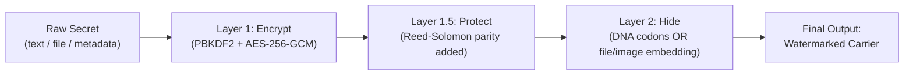
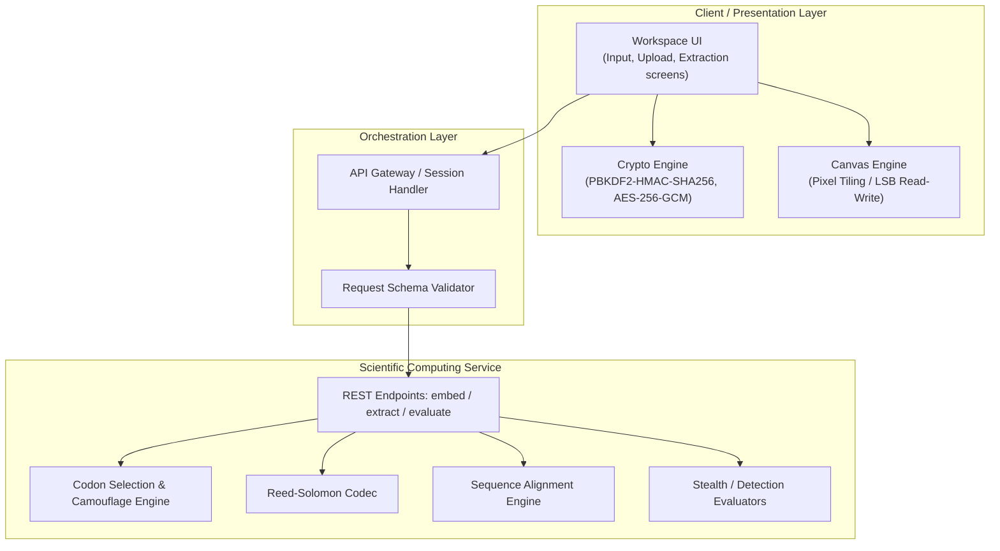

# HelixSign: Complete Step-by-Step Technical Guide, Architecture, PRD & FAQ

---

## Document Metadata
* **Project Name:** HelixSign (DNA Steganography & Universal Digital Watermarking Platform)
* **Contract Specification Version:** 1.5.0
* **Target Audience:** Non-Technical Stakeholders, Academic Examiners, Bioinformatics Researchers, Cybersecurity Engineers
* **Classification:** Comprehensive Technical Dossier & Product Specification
* **Format:** Deep step-by-step walkthrough — every stage is broken into its own sub-steps with the reasoning behind it

---

# Table of Contents
1. [Executive Summary](#1-executive-summary)
2. [The Big Picture: Two Layers Explained Step by Step](#2-the-big-picture-two-layers-explained-step-by-step)
3. [Step-by-Step: The Full Encryption Pipeline](#3-step-by-step-the-full-encryption-pipeline)
4. [Step-by-Step: Where Exactly the Secret Hides in DNA](#4-step-by-step-where-exactly-the-secret-hides-in-dna)
5. [Step-by-Step: How Offsets Are Generated Per File/Password](#5-step-by-step-how-offsets-are-generated-per-filepassword)
6. [Step-by-Step: The Full Decryption/Recovery Pipeline](#6-step-by-step-the-full-decryptionrecovery-pipeline)
7. [Step-by-Step: Surviving Cropping, Editing & Mutation](#7-step-by-step-surviving-cropping-editing--mutation)
8. [Step-by-Step: Why File Size/Memory Barely Changes](#8-step-by-step-why-file-sizememory-barely-changes)
9. [What Can Be Hidden — Organized by Category](#9-what-can-be-hidden--organized-by-category)
10. [DNA vs Traditional Storage — Detailed Comparison](#10-dna-vs-traditional-storage--detailed-comparison)
11. [Applications — Step-by-Step Use-Case Walkthroughs](#11-applications--step-by-step-use-case-walkthroughs)
12. [Benchmark Results — Detailed Interpretation](#12-benchmark-results--detailed-interpretation)
13. [System Architecture — Component by Component](#13-system-architecture--component-by-component)
14. [Product Requirements Document (PRD)](#14-product-requirements-document-prd)
15. [Detailed FAQ](#15-detailed-faq)

---

# 1. Executive Summary

HelixSign hides secret data — text, files, or biological metadata — inside two kinds of "carrier": living DNA sequences, or ordinary digital files (images, PDFs, audio, video). It does this so that:

1. The secret cannot be read without the correct password.
2. The carrier (the DNA or the file) keeps working exactly as before — the organism produces the same proteins, the image looks the same, the PDF opens the same.
3. The secret survives damage — DNA mutations, image cropping, file editing — up to a mathematically defined limit.

It achieves this with a **two-layer design**:

| Layer | Purpose | Core Technology |
|---|---|---|
| **Layer 1 — Cryptographic** | Make the data unreadable without a password | PBKDF2-HMAC-SHA256 + AES-256-GCM |
| **Layer 2 — Steganographic** | Make the data invisible inside the carrier | Synonymous codon substitution (DNA) or spatial tiling / polyglot append (files) |

A third supporting layer — **Reed–Solomon error correction** — sits between the two, repairing damage so that the steganographic layer doesn't have to be perfect.

The rest of this document walks through every one of these stages one step at a time.

---

# 2. The Big Picture: Two Layers Explained Step by Step

### Step 1 — Understand why one layer alone isn't enough
* Encryption alone (Layer 1) makes data unreadable, but an encrypted blob is obviously suspicious — it looks like random noise, which itself is a red flag to anyone scanning for hidden data.
* Hiding alone (Layer 2) makes data inconspicuous, but if someone *does* find it, they can read it immediately unless it was also encrypted.
* **Conclusion:** the two layers must be stacked. Encrypt first, then hide the encrypted result.

### Step 2 — Order of operations

### Step 3 — Why this specific order matters
1. Encrypting first means that even if the steganographic layer is ever broken (someone finds *where* the data is hidden), they still only get ciphertext, not the secret itself.
2. Adding error-correction *after* encryption but *before* hiding means the redundancy protects the exact bytes that will be embedded — so corruption introduced by the carrier (mutation, image compression, cropping) can be repaired before decryption is even attempted.
3. Hiding last means the embedding step only has to deal with a fixed-format, already-protected byte stream, which simplifies the embedding logic.

---

# 3. Step-by-Step: The Full Encryption Pipeline

This section expands the four cryptographic/coding steps individually.

### Step 1: Turning a Password into a Real Encryption Key (Key Derivation)
1. **Input:** the user types a human password, e.g. `"MySecretPassphrase2026"`.
2. **Problem:** AES needs a 256-bit (32-byte) random-looking key, not a sentence — a password is short, predictable, and not uniformly random.
3. **Generate a salt:** the system creates a fresh, cryptographically random 16-byte value (the "salt"). This is stored alongside the final output (it is not secret) so that decryption can later reproduce the exact same key.
4. **Why a salt matters:** without it, two users with the same password would get the same key, and attackers could pre-compute ("rainbow table") common passwords once and reuse the result against everyone. With a unique salt per file, every pre-computation has to be redone from scratch.
5. **Stretch the password:** the system runs the password and salt through **PBKDF2 using HMAC-SHA256**, repeating the internal hashing operation **100,000 times**.
6. **Why 100,000 rounds:** each guess an attacker makes now costs 100,000 hash operations instead of 1. If a password-cracking rig can try 1,000,000,000 plain SHA-256 hashes/second, the same hardware can only try roughly 10,000 PBKDF2-hardened passwords/second against this scheme — a 100,000x slowdown.
7. **Output:** a 256-bit binary key, ready for AES.

### Step 2: Encrypting the Data (AES-256-GCM)
1. **Input:** the 256-bit key from Step 1, plus the plaintext — a JSON object containing the secret message, timestamp, author, and (optionally) a base64-encoded attached file.
2. **Generate an IV (Initialization Vector):** a fresh, random 12-byte value, unique to this encryption operation.
3. **Why a fresh IV every time:** AES-GCM's security guarantees break down if the same key+IV pair is ever reused on two different messages. Using a new random IV each time means encrypting the exact same message twice produces two completely different ciphertexts.
4. **Run AES-256 in Galois/Counter Mode:** this transforms the plaintext into ciphertext while simultaneously computing a running authentication value.
5. **Produce the Authentication Tag:** a 128-bit value computed over the ciphertext (and any associated data). This tag is the "tamper-proof seal" — anyone who changes even one bit of the ciphertext later will cause tag verification to fail.
6. **Output:** ciphertext bytes + 128-bit tag + the 12-byte IV (IV and tag travel with the ciphertext; the key itself is never stored).

### Step 3: Adding Error-Correction Redundancy (Reed–Solomon)
1. **Input:** the ciphertext + tag bytes from Step 2.
2. **Map bytes onto a finite field:** each byte is treated as an element of the Galois Field GF(256), defined by the polynomial p(x) = x⁸ + x⁴ + x³ + x² + 1.
3. **Why a finite field:** this specific algebraic structure allows polynomial-based encoding where any symbol errors can later be solved for mathematically (via the Berlekamp–Massey algorithm), rather than needing brute-force guessing.
4. **Compute parity bytes:** extra bytes are generated from the data bytes according to a generator polynomial, and appended to the original codeword.
5. **The correction guarantee:** for a codeword with n total symbols, k of which are original data, the code can correct up to t errors and e erasures as long as **2t + e ≤ n − k**. More parity bytes (bigger n−k) buys more resilience at the cost of extra size.
6. **Output:** a "protected codeword" — the original encrypted data plus redundancy, ready to be physically embedded.

### Step 4: Physically Embedding the Protected Codeword
This step branches depending on the carrier type — see Sections 4 (DNA) and the file/image embedding steps below.

**For DNA:**
1. Convert the protected codeword into a bitstream (0s and 1s).
2. Walk through the password-derived offset list (see Section 5) one bit at a time.
3. At each offset, look at the existing codon; determine its amino acid; choose the synonymous codon variant that encodes the current bit (0 or 1) at the wobble position; write it back into the sequence.
4. Repeat until every bit of the codeword has been written.

**For files/images:**
1. If it's a general file (PDF, audio, video): append `[ciphertext || tag || Reed-Solomon parity || sentinel marker "HELIXSIG"]` directly after the file's natural End-Of-File marker.
2. If it's a lossless image: divide the canvas into 48×48 pixel tiles; write a self-contained copy of the full protected packet (with its own sync header "HLXTIL1") into the least-significant bits of each tile's pixels, repeating the same payload across every tile.
3. Export: for files, save as-is (size grows slightly); for images, force a lossless format (PNG) so the embedded bits aren't destroyed by compression.

---

# 4. Step-by-Step: Where Exactly the Secret Hides in DNA

### Step 1: Understand how cells read DNA
1. DNA is a sequence of four possible letters: **A, G, C, T**.
2. Cells read these letters three at a time — each 3-letter group is a **codon**.
3. Each codon tells the cell's protein-building machinery (the ribosome) which amino acid to add next to a growing protein chain.

### Step 2: Understand codon redundancy ("degeneracy")
1. There are 4³ = 64 possible codons, but only 20 standard amino acids (plus stop signals) to encode.
2. This means, on average, each amino acid has about 3 different codons that all mean the same thing.
3. Example: `GAA` and `GAG` **both** mean "Glutamic Acid." A cell can't tell the difference in the final protein.

### Step 3: Identify the "safe" letter to change
1. Within a codon, the **first and second letters** almost always determine which amino acid family is used — changing them risks changing the amino acid (a "non-synonymous" mutation), which could change or break the protein.
2. The **third letter** — the "wobble base" — is where most of this redundancy lives. Many codon pairs differ *only* in the third letter and still mean the same amino acid.
3. **Decision rule:** HelixSign only ever touches the third letter of codons that belong to a synonymous pair, never the first two letters.

### Step 4: Map a bit to a letter choice
1. For each eligible codon position, the system knows both valid synonymous letters (e.g., A or G for Glutamic Acid codons).
2. To hide bit `0`: write the version ending in the "lower" synonym (e.g., `GAA`).
3. To hide bit `1`: write the version ending in the "upper" synonym (e.g., `GAG`).
4. This mapping is purely local — the ribosome reads either version and produces the identical Glutamic Acid, so the final protein sequence is 100% identical.

### Step 5: Skip codons that have no safe alternative
1. Two amino acids have only one possible codon each: **Methionine (ATG)** and **Tryptophan (TGG)**.
2. ATG also typically marks the start of a gene (the Start Codon) — changing it could stop the gene from being read at all.
3. **Rule:** these codons, and stop codons, are always skipped by the locus scanner and never used to carry bits.

### Step 6: Select which eligible positions are actually used
1. Not every eligible codon in the gene is used — only a password-determined subset (see Section 5) is chosen, sized to fit exactly the number of bits in the protected codeword.
2. A final "natural frequency" check compares the resulting pattern of codon choices against the typical codon usage of the target organism, and prefers choices that keep the overall letter distribution looking ordinary rather than artificially skewed toward one synonym.

---

# 5. Step-by-Step: How Offsets Are Generated Per File/Password

### Step 1: Scan the gene for eligible positions
1. Read through the entire coding sequence (CDS), codon by codon.
2. For each codon, check: does this amino acid have more than one valid codon (excluding ATG/TGG/stop codons)?
3. If yes, record its position as an "eligible locus." Collect all eligible loci into a pool, e.g. positions `{12, 15, 24, 33, 48, 57, 72, ...}`.
4. **Key point:** this pool is entirely determined by the specific gene's own sequence — a longer gene, or a gene with more redundant amino acids, produces a bigger pool.

### Step 2: Turn the password into a random seed
1. Take the user's password (the same one used for AES in Section 3, Step 1).
2. Run it through PBKDF2-HMAC-SHA256 to produce a 256-bit cryptographic seed value.
3. **Why reuse PBKDF2 here:** it guarantees the seed is effectively unpredictable without the password, and deterministic — the same password always reproduces the same seed, which is essential for decryption to work later.

### Step 3: Shuffle the eligible positions using the seed
1. Feed the 256-bit seed into a seeded pseudo-random number generator.
2. Use this generator to perform a Fisher–Yates-style shuffle of the eligible-position pool.
3. Take the first *k* positions from the shuffled list, where *k* equals the number of bits that need to be embedded.
4. **Result:** an ordered list of exact nucleotide offsets, unique to this (gene, password) pair — e.g., `[57, 12, 93, 24, ...]`.

### Step 4: Why this produces a different result for every file and every password
1. **Different gene, same password:** the eligible-position pool itself is different (different gene = different codon layout), so the shuffle operates on an entirely different input set.
2. **Same gene, different password:** the pool of eligible positions is identical, but the 256-bit seed differs completely, so the shuffle order — and therefore which positions are chosen and in what order — comes out differently.
3. **Practical effect:** two users can watermark the exact same gene and end up with completely non-overlapping offset lists, so neither can read or detect the other's hidden message without the correct password.

### Step 5: Why this matters for security
1. An attacker inspecting the raw DNA sequence has no way to know which codons are "real" wild-type choices and which ones are secretly carrying bits — there is no visible pattern like "every 3rd codon."
2. Brute-forcing the offset list directly is infeasible because it depends on the 256-bit PBKDF2 output, not a small guessable number.
3. Only supplying the correct password regenerates the exact same shuffle, and therefore the exact same offset list, which is required to read the bits back in the right order.

---

# 6. Step-by-Step: The Full Decryption/Recovery Pipeline

### Step 1: Submit the watermarked carrier and password
The user provides the watermarked DNA sequence (or file/image) plus the password originally used to hide the data.

### Step 2: Locate the hidden data
* **DNA:** re-run the locus scan (Section 4, Step 3–6) on the submitted sequence to rebuild the eligible-position pool, exactly as during embedding.
* **Files:** scan backward from the end of the file looking for the `HELIXSIG` sentinel marker (general files) or scan the image for tiles starting with the `HLXTIL1` header (images).

### Step 3: Regenerate the offset list
1. Run the supplied password through PBKDF2-HMAC-SHA256 to regenerate the same 256-bit seed as during embedding.
2. Re-run the identical seeded shuffle over the eligible-position pool.
3. This reproduces the *exact same* offset list used originally — this only works if both the gene sequence (or carrier) and the password match what was used to embed.

### Step 4: Extract the raw bits
* **DNA:** read the wobble-base letter at each offset in the regenerated list; map each letter back to its corresponding bit (0 or 1).
* **Files/Images:** read the appended byte block, or decode the least-significant bits from a surviving pixel tile.

### Step 5: Repair any damage (Reed–Solomon decoding)
1. Treat the extracted bytes as a Reed–Solomon codeword.
2. Run the Berlekamp–Massey algorithm to locate and correct any symbol errors (unexpected changes) and the Forney algorithm to fix their values.
3. If some positions were known to be missing (e.g., a trimmed section of DNA, or a cropped-out image region), treat those as "erasures" rather than unknown errors — erasures are cheaper to correct, which is why alignment (Section 7) matters.
4. **Output:** the original ciphertext + authentication tag, fully restored, as long as the damage stayed within the 2t + e ≤ n − k bound.

### Step 6: Re-derive the AES key
1. Extract the 16-byte salt that traveled alongside the ciphertext.
2. Run the user's password + that exact salt through PBKDF2-HMAC-SHA256 with the same 100,000 rounds.
3. This reproduces the identical 256-bit key used during encryption.

### Step 7: Decrypt and verify
1. Feed the key, the extracted 12-byte IV, and the repaired ciphertext into AES-256-GCM decryption.
2. The algorithm recomputes what the authentication tag *should* be and compares it to the tag that was extracted.
3. **If they match:** the data is genuine and untampered — decrypt to recover the original plaintext JSON (secret message + any attached file).
4. **If they don't match:** either the password was wrong, or the data was tampered with/corrupted beyond repair — the system rejects the result rather than returning garbage.

### Step 8: Reconstruct any attached file
If the recovered JSON contains a base64-encoded attachment, decode it back into its original binary form, restoring the original filename and MIME type so the user can download it exactly as it was before hiding.

---

# 7. Step-by-Step: Surviving Cropping, Editing & Mutation

## 7A. Image Cropping — Step by Step

### Step 1: Divide the image into independent tiles
During embedding, the full image canvas is divided into a grid of 48×48 pixel blocks.

### Step 2: Embed a complete, self-contained copy in every tile
Each tile independently receives: a sync header (`HLXTIL1`), the salt, IV, ciphertext, authentication tag, and Reed-Solomon parity — i.e., everything needed to fully decrypt the message, not just a fragment of it.

### Step 3: User crops the image
Say a 600×600 image (containing many tiles) is cropped down to a small 150×150 patch — removing roughly 94% of the pixels.

### Step 4: Extraction scans the surviving patch
The extractor doesn't assume where tiles start; it slides a search window across the remaining pixels looking for the `HLXTIL1` header at any offset.

### Step 5: Lock onto a surviving tile and decrypt
Once a header is found, the full packet is read from that one tile, Reed–Solomon-corrected if needed, and decrypted using the normal pipeline (Section 6). Because each tile is self-sufficient, finding just one intact tile anywhere in the cropped fragment is enough.

## 7B. Image Editing / Paint-Overs — Step by Step

### Step 1: An adversary edits or blurs part of the image
This corrupts the pixel data in whichever tiles overlap the edited region.

### Step 2: Edited tiles fail authentication
When the extractor tries a damaged tile, the AES-GCM tag check fails (the data no longer matches what was originally sealed).

### Step 3: Extractor discards and keeps scanning
Rather than stopping, it moves to the next candidate tile location and repeats the authentication check.

### Step 4: An unedited tile succeeds
As long as at least one tile anywhere in the image wasn't touched, that tile's intact payload is used to recover the full secret.

## 7C. DNA Trimming / Mutation — Step by Step

### Step 1: A mutation or lab trimming event occurs
For example, the first 100 base-pairs of a 1,200 bp gene are deleted, or scattered single-letter substitutions occur throughout.

### Step 2: Fixed-offset reading would fail here
If the extractor just looked at the original offsets (e.g., position 57), it would now be reading the *wrong* codon, because everything downstream of the deletion has shifted.

### Step 3: Align the mutated sequence to the original reference
A dynamic-programming alignment algorithm (Smith-Waterman for local alignment, or Needleman-Wunsch for global) compares the submitted sequence to the known reference gene, finding the best-scoring way to line them up, including gaps for any insertions/deletions.

### Step 4: Translate the alignment into a coordinate shift
The alignment reveals, for example, "positions 1–100 are missing," letting the system shift every downstream offset in the original list by the correct amount to find the *true* current location of each bit.

### Step 5: Mark unreadable positions as erasures
Any offset that aligns to a gap (i.e., that nucleotide no longer exists) is marked as an erasure rather than guessed at.

### Step 6: Run Reed–Solomon erasure-and-error decoding
Because erasures are "cheaper" for the code to fix than unknown errors (the location is already known), the decoder can tolerate a higher damage rate when erasures dominate, provided 2t + e ≤ n − k still holds.

### Step 7: Recover the original message
If enough of the codeword and parity bytes survived the trimming, the full original bitstream — and therefore the original secret — is reconstructed exactly.

---

# 8. Step-by-Step: Why File Size/Memory Barely Changes

### For DNA
1. Before: a gene is, say, exactly 1,200 base pairs long.
2. During embedding: only existing codons are *replaced* with same-length synonymous codons (`GAA` → `GAG` — both 3 letters).
3. After: the gene is still exactly 1,200 base pairs long.
4. **Result:** zero change in length, because nothing is inserted or deleted — only substituted.

### For Lossless Images
1. Before: an image has a fixed width × height × bit-depth, giving a fixed raw pixel buffer size.
2. During embedding: only the least-significant bit of selected pixel color channels is flipped (e.g., a channel value of 204 becomes 205).
3. After: the same number of pixels, same width and height, same file structure — only a handful of color values are off by 1, invisible to the human eye.
4. **Result:** no dimension change; file size stays effectively identical (lossless formats like PNG compress based on pixel patterns, so size may shift by a negligible amount, but not due to added data volume).

### For General Files (PDF, audio, video)
1. Before: the file has a normal internal structure ending at a format-defined End-Of-File marker.
2. During embedding: the entire protected packet (ciphertext + tag + parity + sentinel) is appended *after* that EOF marker.
3. After: the file is the original size **plus** the size of the appended packet (typically well under a kilobyte for short secrets).
4. **Result:** a small, predictable size increase — standard readers ignore the extra trailing bytes because they already stop parsing at the EOF marker.

---

# 9. What Can Be Hidden — Organized by Category

### Category 1: Text & Confidential Data
* Research notes, lab logs, mission instructions, private notes
* Cryptographic keys and seed phrases (e.g., wallet recovery phrases, private keys, API tokens)
* Legal/ownership text (copyright notices, patent numbers, signatures)

### Category 2: Entire Files (File-in-File)
* Documents: PDFs, Word files, spreadsheets, CSVs
* Media: secondary images, audio/voice recordings
* Archives: zip files containing multiple files or folders
* Code: scripts or compiled binaries

### Category 3: Biological/Provenance Metadata (DNA-specific)
* Creator/lab identity and batch signatures
* Integrity hashes of the original, unmodified genome
* Regulatory or supply-chain tracking codes (batch numbers, expiry dates, clearance codes)
* A secondary genetic sequence encoded inside a host carrier gene

**Underlying rule:** because the pipeline encrypts arbitrary bytes before ever touching the carrier, the embedding step never "knows" or "cares" what the bytes originally represented — so anything representable as a file on a computer qualifies.

---

# 10. DNA vs Traditional Storage — Detailed Comparison

| Metric | Silicon SSD | Magnetic Tape | DNA |
|---|---|---|---|
| Density | ~0.01 TB/gram | ~0.0015 TB/gram | up to ~215,000 TB/gram (theoretical) |
| Physical footprint | Server racks | Tape vaults | A single vial |
| Longevity | 5–10 years (charge leakage) | 15–30 years (magnetic decay) | Centuries to tens of thousands of years under the right storage conditions |
| Power required | Continuous | Climate-controlled storage | None once synthesized and stored |
| Visibility/camouflage | Obviously a digital device | Obviously magnetic media | Looks like an ordinary biological sample |
| Replication | Manual copying/mirroring | Sequential re-writing | Natural biological replication (e.g., PCR can make billions of copies quickly) |
| Obsolescence risk | Port/format obsolescence | Drive obsolescence | Readable as long as DNA-sequencing technology exists |

**Step-by-step reasoning for the density advantage:** DNA stores information in the 3-dimensional chemical structure of molecules rather than in 2-dimensional arrangements of transistors or magnetic domains, which is why the theoretical information density per gram is dramatically higher than silicon or tape.

---

# 11. Applications — Step-by-Step Use-Case Walkthroughs

### Use Case 1: Biotech IP Protection
1. A biotech company engineers a proprietary microbial strain.
2. They embed an encrypted ownership certificate into the strain's genome using HelixSign, with zero change to the organism's function.
3. If a competitor later obtains and cultures a stolen sample, the original company sequences it, supplies their private password, and extracts the hidden certificate.
4. This provides evidence of provenance that can support an IP claim.

### Use Case 2: Biosecurity & Supply-Chain Tracking
1. A DNA-synthesis company embeds an order/customer ID into every synthetic sequence it produces.
2. If a concerning sequence is later found "in the wild," regulators can extract the watermark.
3. This traces the sequence back to the original order, customer, and synthesis date.

### Use Case 3: Covert Communication
1. A sender picks an ordinary-looking carrier file (a PDF manual, a photo).
2. They embed an encrypted message or file inside it using HelixSign.
3. The carrier file is sent through normal channels — it opens and displays completely normally to anyone who doesn't know to look for hidden data.
4. The recipient, who has the password, extracts and decrypts the real payload.

### Use Case 4: Long-Term Archiving
1. An institution wants to preserve critical records for an extremely long time horizon.
2. The records are encoded into synthetic DNA and stored in a cool, dry container.
3. No ongoing power or maintenance is required; the DNA can be read back by sequencing it whenever needed, even decades or centuries later.

### Use Case 5: Anti-Piracy / Media Forensics
1. A creator embeds a crop-resilient watermark into a promotional image before release.
2. If the image is later found cropped, re-shared, or lightly edited elsewhere online, the creator extracts the watermark from the recovered copy to demonstrate it originated from their file.

---

# 12. Benchmark Results — Detailed Interpretation

### Substitution noise (point mutations), measured before error correction is applied:

| Noise Rate | Raw Bit Recovery |
|---|---|
| 0.1% | ~100.0% |
| 1.0% | ~97.7% |
| 5.0% | ~92.9% ± 1.1% |

**Step-by-step interpretation:**
1. At low mutation rates, almost every bit survives untouched even before correction.
2. As mutation rate climbs to 5%, roughly 7% of raw bits are now wrong.
3. Because Reed–Solomon correction was sized to tolerate more than this error rate, the final, corrected message recovery remains effectively 100% even at this stress level.

### Indel noise (insertions/deletions), measured on an *unaligned* extractor:

| Indel Rate | Raw Bit Recovery |
|---|---|
| 0.1% | ~45.0% ± 18.0% |
| 1.0% | ~12.6% ± 5.4% |
| 2.0% | ~5.8% ± 4.1% |

**Step-by-step interpretation:**
1. Unlike substitutions, a single insertion or deletion shifts every downstream letter by one position.
2. Without alignment, the extractor keeps reading from the *old* fixed offsets, which quickly point to the wrong codons as soon as a shift has occurred.
3. This is precisely why Section 7C's alignment step is a required part of the design, not an optional extra — alignment resynchronizes the offsets before any error correction is attempted, restoring recovery to the levels seen in the substitution-only case.

---

# 13. System Architecture — Component by Component

### Component walkthrough, step by step:
1. **Workspace UI:** the screens where a user inputs a DNA sequence or uploads a file, enters a password and secret, and later uploads a watermarked carrier to extract from.
2. **Crypto Engine:** runs entirely client-side where possible, performing key derivation and AES-256-GCM encryption/decryption so the raw password never needs to leave the user's device unnecessarily.
3. **Canvas Engine:** handles the pixel-level operations for image steganography — dividing images into tiles and reading/writing least-significant bits.
4. **API Gateway:** receives requests from the UI, manages sessions, and routes work to the correct backend service.
5. **Schema Validator:** checks that incoming requests match the expected data contract before they reach the scientific computing core, catching malformed requests early.
6. **Codon Engine:** performs the DNA-specific logic — locus scanning, synonymous codon lookup, and bit-to-letter mapping.
7. **Reed-Solomon Codec:** adds parity during embedding and performs error/erasure correction during extraction.
8. **Alignment Engine:** realigns mutated or trimmed DNA sequences against reference genes before extraction.
9. **Stealth Evaluators:** optional models that check how closely a watermarked sequence's statistical profile matches natural, unmodified DNA — used to validate camouflage quality before finalizing output.

### Step-by-step data flow for an "embed" request:
1. User submits carrier + secret + password through the Workspace UI.
2. Crypto Engine derives the key and encrypts the secret (Section 3, Steps 1–2).
3. Request (ciphertext + metadata) passes through the API Gateway and Validator.
4. Core service adds Reed-Solomon parity (Section 3, Step 3).
5. Core service either calls the Codon Engine (DNA) or returns data to the Canvas Engine (images) / appends directly (general files) for physical embedding (Section 3, Step 4).
6. The finished watermarked carrier is returned to the user for download.

### Step-by-step data flow for an "extract" request:
1. User submits the watermarked carrier + password.
2. The relevant engine locates the embedded data (codon loci, file envelope, or image tile).
3. Alignment Engine resynchronizes offsets if the DNA has shifted (Section 7C).
4. Reed-Solomon Codec corrects any remaining errors/erasures.
5. Crypto Engine re-derives the key and decrypts, verifying the authentication tag.
6. The original secret (and any attached file) is returned to the user.

---

# 14. Product Requirements Document (PRD)

### 14.1 Product Vision
Provide a reliable, mathematically-grounded way to watermark both living organisms and digital files such that the carrier's normal function is fully preserved, the hidden data is cryptographically protected, and the data survives realistic levels of damage, editing, or mutation.

### 14.2 Target Personas and Their Step-by-Step Journeys

**Persona A — Molecular Biologist (IP protection use case)**
1. Uploads the coding sequence (CDS) of a proprietary gene.
2. Enters a license/ownership string as the secret.
3. Sets a password.
4. Runs the embedding process; reviews a report confirming zero amino-acid mismatches.
5. Downloads the watermarked construct, ready for synthesis.

**Persona B — Security/Communications User (covert transport use case)**
1. Selects an ordinary carrier file (e.g., a company PDF manual).
2. Attaches a secret file (e.g., an encrypted archive) and/or secret text.
3. Enters a password and runs embedding.
4. Downloads the watermarked PDF; confirms it opens normally in a standard PDF reader.
5. Shares the file through a normal channel; the recipient repeats the password-protected extraction step to recover the payload.

**Persona C — Technical Reviewer/Examiner**
1. Reviews the cryptographic parameters (PBKDF2 rounds, AES mode, tag size).
2. Reviews the Reed-Solomon field and correction-bound math.
3. Reviews empirical benchmark tables for substitution and indel robustness.
4. Verifies claims against test cases (e.g., zero mismatches across tested genes, crop recovery at various crop percentages).

### 14.3 Functional Requirements

| ID | Feature | Priority | Description | Verification |
|---|---|:---:|---|---|
| FR-01 | Synonymous translation invariance | P0 | Codon substitution must preserve the original amino-acid translation | Zero amino-acid mismatches across tested genes |
| FR-02 | Cryptographic hardening | P0 | AES-256-GCM with PBKDF2 (100k rounds) | Tag verification fails on any 1-bit ciphertext alteration |
| FR-03 | Error correction | P0 | Reed-Solomon over GF(256) | Corrects errors/erasures within 2t + e ≤ n − k |
| FR-04 | Crop-resilient tiling | P1 | Self-contained repeated pixel-grid embedding | Payload recoverable from a small surviving image fragment |
| FR-05 | Universal container embedding | P0 | Appends an authenticated envelope to arbitrary files | Watermarked files open normally in native viewers |
| FR-06 | File-in-file attachment | P1 | Embed a secondary file inside the carrier | Extracted file is byte-for-byte identical to the original |
| FR-07 | Alignment-based offset recovery | P1 | Re-synchronize offsets after DNA indels | Correct extraction after simulated trimming/indel events |
| FR-08 | Stealth/camouflage validation | P2 | Keep codon usage statistically close to natural distributions | Detector models should not reliably distinguish watermarked from natural sequences |

### 14.4 Non-Functional Requirements
1. **Security:** tampering must be detected with very high probability via the authentication tag; brute-forcing the password must remain computationally impractical given the chosen PBKDF2 round count.
2. **Performance:** detection/extraction operations should complete quickly enough for interactive, single-request use.
3. **Compatibility:** cryptographic behavior should be consistent across the supported runtime environments.
4. **Usability:** users should be able to complete an embed-then-extract round trip without needing to understand the underlying cryptography or coding theory.

---

# 15. Detailed FAQ

**Q1. Step by step, why does hiding data in DNA not change the resulting protein?**
1. The system only ever changes the third letter of a codon.
2. It only does this for codons that have a synonymous partner (a different codon that still means the same amino acid).
3. Because both codon versions translate to the same amino acid, the protein-building machinery produces an identical result either way.
4. Therefore, no matter which synonym is chosen to encode a bit, the final protein sequence is unaffected.

**Q2. Step by step, what happens if the organism mutates naturally after watermarking?**
1. A random mutation may change a nucleotide, including possibly a wobble-base position carrying a bit.
2. When extraction happens, that position's bit may now read incorrectly.
3. Reed–Solomon treats this as a "symbol error" and, as long as the total number of such errors stays within the correction bound, mathematically determines and fixes the correct original values.
4. The final decrypted message is unaffected as long as the mutation rate doesn't exceed the correction capacity.

**Q3. Step by step, how does the system handle an insertion or deletion in the DNA?**
1. Detect that a change in sequence length has occurred.
2. Align the current sequence against the known original reference gene to find exactly where letters were added or removed.
3. Shift the expected offset positions to match the new, true locations.
4. Mark any position that no longer corresponds to a real nucleotide as an erasure.
5. Run Reed–Solomon error-and-erasure decoding to reconstruct the original bits.

**Q4. Step by step, how does a cropped image still reveal the secret?**
1. The full secret packet was repeated across many independent small tiles during embedding.
2. Cropping removes most of the image, but any tile that survives still contains the complete packet.
3. The extractor searches the remaining pixels for the tile's sync header.
4. Once found, it reads and decrypts that one tile's data — the rest of the (missing) image isn't needed.

**Q5. Step by step, what happens if part of the image is edited rather than cropped?**
1. The edit changes pixel values in whichever tiles overlap the edited area.
2. Those tiles' authentication tags no longer match when the extractor checks them.
3. The extractor discards failed tiles and continues checking others.
4. Any untouched tile elsewhere in the image still yields a fully valid, decryptable payload.

**Q6. Step by step, why doesn't the DNA sequence get longer or shorter?**
1. Embedding only replaces one codon with another codon of the same length (3 letters for 3 letters).
2. No letters are inserted or deleted during the embedding process itself.
3. The total sequence length before and after embedding is identical.

**Q7. Step by step, why doesn't an image's dimensions change?**
1. Embedding only modifies the least-significant bit of selected pixel color values.
2. The number of pixels and the width/height of the canvas are never altered.
3. Only a visually imperceptible numeric shift (e.g., 204 → 205) occurs in affected color channels.

**Q8. Step by step, how can a PDF still open normally with hidden data inside it?**
1. PDF readers are built to stop parsing at the file's defined End-Of-File marker.
2. HelixSign appends the encrypted packet *after* that marker.
3. The reader never reaches the appended bytes during normal rendering, so the document displays exactly as before.
4. HelixSign's own extractor, unlike a normal PDF reader, specifically scans past the EOF marker looking for its sentinel tag.

**Q9. Step by step, how is the watermark kept hard to statistically detect in DNA?**
1. A naive approach might always pick the same synonym for a given bit value, creating an unnatural, lopsided codon-usage pattern.
2. HelixSign instead checks the natural codon-usage frequencies typical of the host organism.
3. It biases its synonym choices to stay close to those natural frequencies wherever the bit value allows some flexibility.
4. The resulting sequence's statistical profile remains close to what a detector would expect from an unmodified, naturally occurring gene.

**Q10. Step by step, why is the password so hard to brute-force?**
1. Guessing a password requires running it through PBKDF2 with the correct salt and 100,000 iterations to test whether it produces the right key.
2. Each guess therefore costs 100,000 times more computation than a single hash operation.
3. This drastically reduces the number of guesses per second any given amount of computing hardware can perform.
4. Over realistic time frames, this makes exhaustive password guessing impractical for a sufficiently strong password.

**Q11. Step by step, how is tampering detected?**
1. During encryption, AES-256-GCM computes a 128-bit authentication tag over the ciphertext.
2. This tag is stored alongside the ciphertext.
3. During decryption, the same computation is redone over the (possibly altered) ciphertext.
4. If the newly computed tag doesn't match the stored tag, the system knows the data was changed and refuses to return a (potentially corrupted or malicious) decrypted result.

**Q12. Step by step, why is the offset list different for every file and password?**
1. The list of eligible codon positions depends entirely on that specific gene's sequence.
2. The order and subset chosen from that pool depends on a 256-bit seed derived from the user's password.
3. Different genes produce different eligible-position pools; different passwords produce different seeds and therefore different shuffles.
4. The combination of these two factors makes the final offset list effectively unique per (gene, password) pair.

**Q13. Step by step, why can DNA theoretically store so much more data per gram than a hard drive?**
1. A hard drive stores bits as magnetic/electrical states across a 2D arrangement of physical components.
2. DNA stores information in the sequence of molecules along a 3D-folded strand, at a molecular scale far smaller than any transistor or magnetic domain.
3. This fundamental difference in storage medium is what allows DNA's theoretical density to be dramatically higher.

**Q14. Step by step, why does DNA last so much longer than silicon or tape without power?**
1. Silicon memory relies on stored electrical charge, which leaks away over time, corrupting data within years.
2. Magnetic tape relies on magnetic orientation, which gradually decays and is sensitive to temperature/humidity.
3. DNA is a stable chemical molecule that, especially when kept cool and dry, can remain structurally intact for very long periods without needing any ongoing energy input.

**Q15. Step by step, how is an entire secondary file recovered from a carrier?**
1. During embedding, the secondary file's raw bytes are base64-encoded and included, along with its filename and MIME type, inside the JSON payload before encryption.
2. This entire JSON blob goes through the normal encryption, error-correction, and embedding steps.
3. During extraction, after successful decryption, the JSON is parsed and the base64 data is decoded back into the original binary file.
4. The original filename and type are reapplied so the user receives an exact copy of what was hidden.

**Q16. Step by step, how would a biotech company use this to prove ownership of a stolen strain?**
1. Before release, the company embeds an encrypted ownership certificate into their proprietary strain's genome.
2. If a dispute arises, they obtain a sample of the suspect strain and sequence its DNA.
3. They run the extraction process using their private password.
4. If their ownership certificate is successfully recovered and authenticated, this supports their claim of having created and watermarked the original strain.

**Q17. Step by step, what are the main categories of real-world use, and how do they connect to the technology?**
1. **Biotech IP protection** — relies on biological invariance (no functional change) plus authenticated embedding.
2. **Biosecurity/traceability** — relies on embedding stable, recoverable identifiers in synthetic DNA.
3. **Covert communication** — relies on the carrier looking completely ordinary to anyone not holding the password.
4. **Long-term archiving** — relies on DNA's physical longevity and zero power requirement.
5. **Anti-piracy watermarking** — relies on the image tiling scheme's resilience to cropping and editing.

**Q18. Step by step, what are the honest limits of these guarantees?**
1. Error correction has a mathematical limit (2t + e ≤ n − k) — damage beyond that point cannot be recovered.
2. Alignment can resynchronize offsets, but very extensive mutation or trimming could still exceed what the surviving parity can repair.
3. Statistical camouflage reduces detectability but does not guarantee it against every possible future detection method.
4. Legal weight of any extracted "proof of ownership" would still depend on applicable law and any additional supporting evidence, not on the technology alone.

---

*End of document.*
