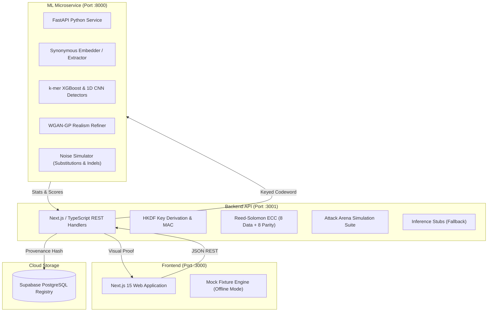

# HelixSign: Stealth-Tested Ownership Tagging for Engineered DNA

[](https://nextjs.org/)
[](https://www.typescriptlang.org/)
[](https://python.org/)
[](https://pytorch.org/)
[](https://supabase.com/)
[](LICENSE)

> **One-Line Pitch:** An invisible, damage-resistant ownership stamp for engineered synthetic genes, featuring mathematical proof of 100% protein preservation, measured stealth against AI detectors, and an interactive attack arena.

---

## 1. Overview & Problem

Biotechnology startups, university laboratories, and agricultural developers invest millions of dollars into designing novel engineered organisms, genetic constructs, and synthetic strains. However:
- **No Traceability:** When proprietary strains leak or IP is stolen, proving provenance is biologically difficult.
- **Fragile Tags:** Obvious synthetic tag sequences (e.g., non-coding barcode inserts) are immediately spotted and excised.
- **Host Toxicity:** Randomly inserted foreign DNA can disrupt regulatory machinery or harm host viability.
- **Mutation Decay:** Over generations, organisms naturally accumulate point mutations and indels that corrupt naive digital tags.

### The HelixSign Solution
HelixSign embeds a compact, cryptographically secured, error-corrected ownership watermark (Owner, Project, Batch, HMAC) into the **synonymous codon choices** of an open reading frame (CDS):
1. **100% Protein Identity:** The expressed amino acid sequence remains identical by construction.
2. **Adversarial Realism:** Synonymous choices are nudged to mirror the host organism (*E. coli* K-12) codon frequency and k-mer statistics, evading AI detectors.
3. **Damage Resilience:** A Reed-Solomon Error Correction Code (ECC) enables complete payload recovery even through biological mutation and targeted deletion attacks.

---

## 2. System Architecture



---

## 3. Monorepo Structure & Strict 3-Folder Ownership

To prevent merge conflicts during parallel development across the 3-person team, this repository enforces **strict folder boundaries**:

```
HelixSign/
├── frontend/                       # [Person 1 Territory] Next.js Web App
│   ├── app/                        # App Router routes & layouts
│   ├── components/                 # UI components, diff viewer, charts
│   ├── lib/                        # Client state, styling utilities
│   └── package.json                # Frontend dependencies
│
├── backend/                        # [Person 2 Territory] Next.js API & Orchestration
│   ├── src/app/api/                # REST endpoints (/stamp, /verify, /stealth, etc.)
│   ├── src/core/                   # HKDF crypto, 64-bit payload, Reed-Solomon ECC
│   ├── src/attacks/                # Mutation, deletion, trimming, synonymous attacks
│   ├── src/services/               # Supabase database & ML bridge
│   └── package.json                # Backend dependencies
│
├── ml/                             # [Person 3 Territory] Python Data & ML Engine
│   ├── data/                       # E. coli reference CDS & codon usage tables
│   ├── genestamp_ml/               # Biopython translation, embedder, extractors
│   │   └── detectors/              # k-mer XGBoost and 1D CNN detectors
│   ├── training/                   # WGAN-GP training & offline evaluation
│   ├── api/                        # FastAPI inference microservice (:8000)
│   └── requirements.txt            # Python dependencies
│
├── contracts/                      # [Shared & Frozen] API Specifications
│   ├── api-spec.json               # OpenAPI 3.1 Contract
│   └── fixtures/                   # Standard request/response JSON fixtures
│
├── 01-PRD.md                       # Product Requirements Document
├── 02-TRD.md                       # Technical Requirements Document
├── 03-FRONTEND_GUIDE.md            # Person 1 Developer Manual
├── 04-BACKEND_GUIDE.md             # Person 2 Developer Manual
├── 05-ML_DATA_GUIDE.md             # Person 3 Developer Manual
├── 06-MONITORING_AND_INTEGRATION_GUIDE.md # Cross-service telemetry & connectivity
└── README.md                       # You are here
```

---

## 4. Team Guides & Roles

Each developer has a dedicated, self-contained guide with complete specifications, branching policies, and delivery checklists:

| Member | Focus | Assigned Directory | Guide Document |
| :--- | :--- | :--- | :--- |
| **Person 1** | Frontend Lead (UI, UX, Charts, Diffs) | `frontend/` | [03-FRONTEND_GUIDE.md](file:///d:/coding_files/HelixSign/03-FRONTEND_GUIDE.md) |
| **Person 2** | Backend Lead (API, Crypto, ECC, Registry) | `backend/` | [04-BACKEND_GUIDE.md](file:///d:/coding_files/HelixSign/04-BACKEND_GUIDE.md) |
| **Person 3** | ML & Data Lead (Embedder, Detectors, GAN) | `ml/` | [05-ML_DATA_GUIDE.md](file:///d:/coding_files/HelixSign/05-ML_DATA_GUIDE.md) |
| **All** | System Integration, Health, & Monitoring | Cross-cutting | [06-MONITORING_AND_INTEGRATION_GUIDE.md](file:///d:/coding_files/HelixSign/06-MONITORING_AND_INTEGRATION_GUIDE.md) |

---

## 5. Zero-Conflict Git Workflow

1. **Base Branch:** Always branch from `develop`. Never push directly to `main` or `develop`.
2. **Branch Naming Conventions:**
   - Person 1 (Frontend): `feat/frontend/<feature-name>`
   - Person 2 (Backend): `feat/backend/<feature-name>`
   - Person 3 (ML): `feat/ml/<feature-name>`
3. **Commit Rule:** Never touch or commit files outside your assigned directory.
4. **Daily Sync Protocol:**
   ```bash
   git checkout develop
   git pull origin develop
   git checkout feat/<your-area>/<feature>
   git merge develop
   ```

---

## 6. Quickstart: Running Locally

### Step 1: Clone & Configure Environments
```bash
git clone https://github.com/your-org/HelixSign.git
cd HelixSign
```

Copy the example environment files:
```bash
# Frontend
cp frontend/.env.example frontend/.env.local

# Backend
cp backend/.env.example backend/.env.local

# ML Microservice
cp ml/.env.example ml/.env
```

### Step 2: Start Services (3 Independent Terminals)

#### Terminal 1: ML Microservice (Python)
```bash
cd ml
python -m venv .venv
source .venv/bin/activate    # Windows: .venv\Scripts\activate
pip install -r requirements.txt
uvicorn api.serve:app --host 127.0.0.1 --port 8000 --reload
```
*Docs available at:* `http://127.0.0.1:8000/docs`

#### Terminal 2: Backend API (Node / Next.js)
```bash
cd backend
npm install
npm run dev
```
*Health check:* `http://localhost:3001/api/health`

#### Terminal 3: Frontend Web App (Next.js)
```bash
cd frontend
npm install
npm run dev
```
*Open application:* `http://localhost:3000`

---

## 7. Core Feature Suite

### 1. Stamp Studio (P0)
- Input: Coding sequence (CDS) + metadata (Owner, Project, Batch).
- Output: Stamped FASTA sequence.
- **Proof Panel:** Real-time side-by-side amino acid translation showing **100% protein match**, interactive codon mutation diff highlighter, GC% delta, and host Codon Adaptation Index (CAI) similarity score.

### 2. Verify & Authenticate (P0)
- Input: Suspect or mutated DNA sequence.
- Output: Provenance verification verdict, decoded owner/batch metadata, and Reed-Solomon symbol error correction count.

### 3. Stealth Check (P0)
- Evaluates the stamped sequence against a naive watermarking baseline using two AI detectors:
  - **Detector 1:** k-mer frequency features with XGBoost.
  - **Detector 2:** 1D Deep Convolutional Neural Network (CNN).
- Benchmark: Naive watermark flagged at $>98\%$ probability ($\text{AUC} \approx 1.0$); HelixSign scores near chance ($\text{AUC} \approx 0.50$).

### 4. Stress Lab (P0)
- Interactive sliders for **Substitution Mutation Rate** ($0.1\% - 5.0\%$) and **Indel Rate** ($0.1\% - 2.0\%$).
- Generates live recovery percentage curves across 30 simulated evolutionary channel trials, honestly revealing the watermark breakdown threshold.

### 5. Attacker Arena (P1)
- Simulated adversarial attempts to strip the watermark:
  - Random Point Mutation
  - 5' and 3' End Trimming
  - Contiguous Block Deletion
  - Synonymous Codon Shuffling (preserves protein, tests watermark survival)
  - Synonymous Re-encoding (adversarial rewrite)

### 6. Forensic Trace (P1)
- "Shazam for Strains": Upload an unknown, corrupted sequence to search the Supabase provenance registry and retrieve top matching original constructs with highlighted mutation zones.

### 7. Provenance Registry (P0)
- Central audit log recording construct timestamps, owner signatures, project batches, and SHA-256 sequence integrity hashes.

---

## 8. Live 3-Minute Demo Script

1. **Stamp (0:00 - 1:00):** Paste a real *E. coli* gene. Enter ownership data. Hit *Stamp*. Show the **100% Protein Identity Proof** and highlighted synonymous codon diffs.
2. **Stealth Check (1:00 - 1:45):** Run the AI detector suite. Show how naive tags get caught with $\sim 100\%$ confidence while HelixSign passes at $\sim 50\%$ (indistinguishable from native host DNA).
3. **Stress Lab (1:45 - 2:30):** Increase mutation noise to $2.0\%$. Run 30 trials. Show the live recovery curve surviving with $100\%$ recovery.
4. **Attacker Arena (2:30 - 3:15):** Execute an adversarial synonymous shuffle. Show that protein function is preserved while the watermark remains verifiable.
5. **Forensic Trace (3:15 - 3:45):** Upload a mutated "stolen" sample, query the registry, and trace it back to the verified owner.
6. **Wrap-up (3:45 - 4:00):** Review the honest limitations slide (heavy whole-gene recoding, future wet-lab milestone).

---

## 9. Ethics, Biosecurity & Disclaimers

- **Consent-Based Provenance:** HelixSign is designed strictly for intellectual property protection and authorized strain tracing. It is **not** intended for biosecurity evasion or covert messaging.
- **Experimental Notice:** This version demonstrates computational and simulation benchmarks. Wet-lab validation (in-vivo synthesis and sequencing) is targeted for the next development milestone.

---

## 10. Contributors

- **Person 1:** Frontend Lead (`frontend/`)
- **Person 2:** Backend Lead (`backend/`)
- **Person 3:** ML & Data Lead (`ml/`)

